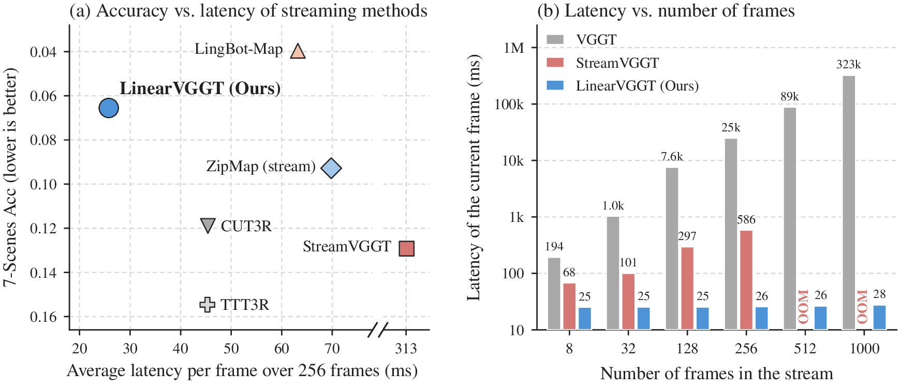
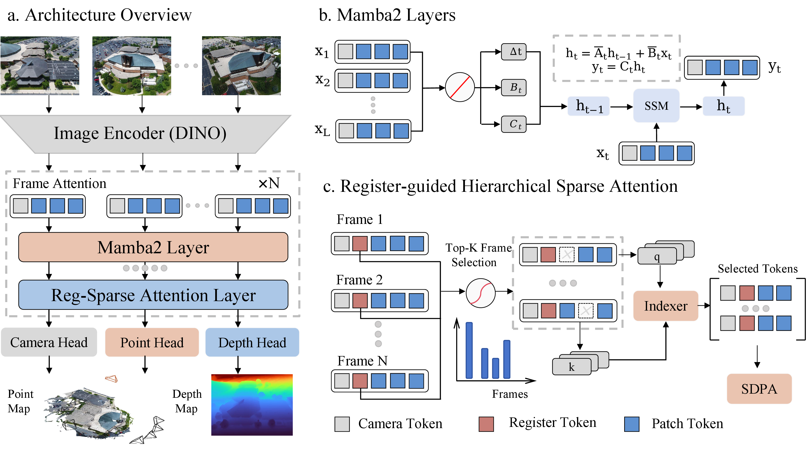

<div align="center">
<h1>LinearVGGT: Linear-time Online Visual Geometry Transformer<br>with Hybrid Architecture</h1>

Haoyu Kang, Pingzhi Li, Ruichen Zhang, Tianlong Chen

UNITES Lab, University of North Carolina at Chapel Hill

<a href="#"></a>
<a href="#"></a>
<a href="LICENSE"></a>

</div>

**LinearVGGT** reconstructs cameras, depth maps and point maps from an uncalibrated video stream, one frame at a time.
Its latency stays at approximately 27 ms for each frame on a stream of 1,024 frames. It is 12 times faster than its teacher StreamVGGT and more accurate.

<p align="center"></p>

## Overview

Causal attention models such as [StreamVGGT](https://github.com/wzzheng/StreamVGGT) keep the tokens of all past frames in a cache, so their total compute grows quadratically with the length of the stream. Recurrent models such as CUT3R and TTT3R keep a state of fixed size at constant cost, but they forget early geometry.

LinearVGGT is a hybrid model that we distill from StreamVGGT. It keeps the image encoder, the frame attention layers and the prediction heads of the teacher, and it changes only the layers that connect frames:

- **Mamba2 layers.** Three of each four global layers become Mamba2 layers. They keep the history in a state of fixed size.
- **Register-guided hierarchical sparse attention.** Each fourth layer selects a small number of past frames with its register tokens (frame routing). A token indexer keeps only a subset of the patch tokens of each cached frame. The first frame is a fixed anchor.
- **Three-stage distillation.** Stage 1 aligns the mixing matrices with the attention matrices of the teacher, Stage 2 aligns the layer outputs, and Stage 3 trains end to end with ground truth and a distillation term. The full training uses 59 GPU hours, which is 9% of the GPU hours of StreamVGGT.
- **Efficient streaming inference.** We capture the fixed-shape work of each frame as CUDA graphs, cache repeated computation and fuse small kernels. This decreases the latency of a frame from 78 ms to 27 ms.

<p align="center"></p>

## Installation

```bash
git clone https://github.com/UNITES-Lab/linear-vggt.git
cd linear-vggt
conda create -n linearvggt python=3.11 -y
conda activate linearvggt

# 1. PyTorch for your CUDA version (tested: torch 2.7.1, CUDA 12.8)
pip install torch==2.7.1 torchvision==0.22.1 --index-url https://download.pytorch.org/whl/cu128

# 2. Mamba2 (compiled CUDA extensions; this step needs the CUDA toolkit and a C++ compiler)
pip install causal-conv1d mamba-ssm

# 3. LinearVGGT and the other packages
pip install -e .                  # the model
pip install -r requirements.txt   # optional: all packages for the evaluation
```

Tested versions: Python 3.11, `mamba-ssm` 2.3.2, `causal-conv1d` 1.7.0, `triton` 3.3.1.

## Usage

This release contains the model code. It does not contain pretrained weights.

```python
import torch
from linearvggt import LinearVGGT

model = LinearVGGT().cuda().eval()          # 18 Mamba2 layers and 6 sparse attention layers, random weights
images = torch.rand(1, 8, 3, 392, 518, device="cuda")       # [B, T, 3, H, W], RGB in [0, 1]
with torch.autocast("cuda", dtype=torch.bfloat16):
    out = model.predict_images(images, streaming=True)      # frames are processed in order

out["depth"]        # [1, T, H, W, 1]  depth maps
out["points"]       # [1, T, H, W, 3]  point maps in the coordinate frame of the first frame
out["pose"]         # [1, T, 9]        camera: translation, quaternion, field of view
out["depth_conf"], out["point_conf"]   # [1, T, H, W] confidence
```

`linearvggt.load_student(path)` loads a checkpoint that `linearvggt.models.linearvggt.export_student` wrote.
Convert the camera encoding to matrices with `streamvggt.utils.pose_enc.pose_encoding_to_extri_intri`.

## Evaluation

The evaluation needs a LinearVGGT checkpoint (`CKPT` below). Prepare the datasets as [docs/eval.md](docs/eval.md) tells you. Then:

```bash
bash scripts/eval_mv_recon.sh    CKPT   # 7-Scenes and NRGBD: Acc, Comp, NC
bash scripts/eval_video_depth.sh CKPT   # Sintel, Bonn, KITTI
bash scripts/eval_monodepth.sh   CKPT   # Sintel, Bonn, KITTI, NYU-v2
bash scripts/eval_pose.sh        CKPT   # Sintel, TUM-dynamics, ScanNet
```

Add `StreamVGGT` as the second argument to evaluate the teacher with the same pipeline, and `--fast_stream` to use the efficient streaming inference.

Measure latency and memory on a stream of random frames:

```bash
python scripts/benchmark_speed.py --teacher STREAMVGGT_CKPT --student CKPT \
    --frames 1024 --output outputs/speed.jsonl
```

## Training

The training code (three-stage distillation from StreamVGGT) is not in this release. We will add it later.

## Repository structure

```
LinearVGGT
├── linearvggt/            our model
│   ├── models/            LinearVGGT: layout, checkpoint format, loading
│   ├── layers/            Mamba2 mixer, register-guided sparse attention
│   └── inference/         streaming inference, CUDA graphs and fused kernels
├── eval/                  multi-view reconstruction, video depth, monocular depth, camera pose
├── scripts/               speed benchmark, evaluation launchers
├── third_party/           code from other projects (see third_party/README.md)
│   ├── streamvggt/        StreamVGGT / VGGT: aggregator, heads, DINOv2 layers, utilities
│   └── dust3r_utils/      DUSt3R / CUT3R utilities for the evaluation
└── docs/                  project page, evaluation guide
```

## Acknowledgements

This code is built on [StreamVGGT](https://github.com/wzzheng/StreamVGGT), [VGGT](https://github.com/facebookresearch/vggt), [CUT3R](https://github.com/CUT3R/CUT3R), [MonST3R](https://github.com/Junyi42/monst3r), [Spann3R](https://github.com/HengyiWang/spann3r) and [Mamba](https://github.com/state-spaces/mamba). The distillation schedule follows MOHAWK. We thank the authors for their work.

## Citation

```bibtex
@article{kang2026linearvggt,
  title   = {Linear-time Online Visual Geometry Transformer with Hybrid Architecture},
  author  = {Kang, Haoyu and Li, Pingzhi and Zhang, Ruichen and Chen, Tianlong},
  journal = {arXiv preprint},
  year    = {2026}
}
```

## License

This project is a derivative of StreamVGGT and has the same license: [CC BY-NC-SA 4.0](LICENSE).
